# 爱丽丝梦游仙境 · 薄荷甜心大冒险

> Mint Parfait Parade —— 一款纯 Canvas 2D 手绘风横版闯关游戏，无需安装任何依赖，下载即玩。

帮爱丽丝拿好纸杯蛋糕，闯过糖果王国：4 大关卡、5 场 BOSS 战，探索、宝箱、变身与翻滚弹反一应俱全。

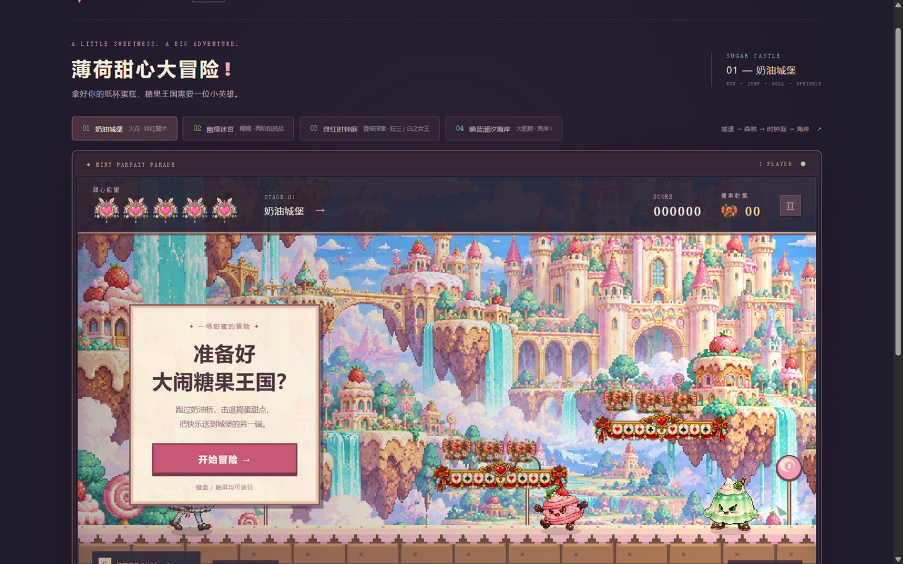

## 目录

- [下载与运行](#下载与运行)
- [操作说明](#操作说明)
- [玩法说明](#玩法说明)
- [关卡与 BOSS 一览](#关卡与-boss-一览)
- [目录结构](#目录结构)
- [声明](#声明)

## 下载与运行

### 方式一：下载打包版（推荐）

到 [Releases](../../releases) 页面下载 `alice-in-wonderland-v1.0.zip`（即「爱丽丝梦游仙境」完整游戏包），解压后**双击「启动游戏.bat」**即可：

- 自动启动本地游戏服务并打开默认浏览器（地址形如 `http://localhost:4174/mint-parade/`）；
- 内置 Node.js 运行时（`runtime/`），无需安装依赖、无需联网；
- 整个文件夹可随意移动或复制到其他位置，启动器使用自身所在路径；
- 重复双击会复用已启动的服务，端口被占用时自动换端口。

> 注意：请保留 `assets`、`runtime`、`serve.mjs`、`launch-game.ps1` 等全部文件。
> 关闭浏览器后服务仍在后台运行，重启电脑即结束，下次双击可再启动。

### 方式二：克隆本仓库

```sh
git clone https://github.com/FineYi666/alice-in-wonderland-game.git
```

然后进入 `mint-parade/` 文件夹，双击其中的「启动游戏.bat」。

也可以手动启动：在该目录执行 `node serve.mjs`，浏览器打开 `http://localhost:4174/mint-parade/`。
不要直接用 `file://` 打开 index.html（精灵切帧需要读取同源图片像素）。

## 操作说明

| 按键 | 作用 |
| --- | --- |
| `A` / `D`（或 ← / →） | 移动 |
| `Space` / `W` / `↑` | 跳跃 |
| `S` + `Space` | 台阶上穿过脚下平台（下台阶） |
| `J`（可按住） | 武器攻击：蛋糕三连击 / 魔法棒射击 / 第四关沙滩海浪 · 空中水球 |
| `S` + `J`（空中） | 下劈攻击，起手到落地期间免疫敌人近身挥击 |
| `K` | 星糖能量满 100 时释放大招 |
| `Shift` / `L` | 翻滚：前 0.48 秒无敌，可穿过弹幕与冲刺，冷却 1.25 秒 |
| `E` | 互动：开宝箱、取钥匙、进门、解封传送门 |
| `Q` | 喝魔法药水，获得 6 秒无敌护盾 |
| `M` | 第三关查看探索地图 |
| `P` / `Esc` | 暂停 / 继续（切换窗口自动暂停） |
| `Space` / `Enter` | BOSS 出场演出时跳过 |

也支持画面下方的触屏按钮（移动 / 攻击 / 跳跃 / 翻滚 / 大招 / 喝药 / 互动 / 地图），以及右下角的声音开关、全屏和重新开始。

## 玩法说明

- **生命与能量**：左上角 5 颗爱心为生命；近战命中与拾取糖果积攒星糖能量（每秒自动恢复 2 点），满 100 按 `K` 放大招。
- **身体接触不扣血**：只有小怪和 BOSS 的攻击命中才受伤，看准起手动作跳跃、翻滚或绕到背后躲避。
- **宝箱与道具**：各关藏有宝箱（按 `E` 打开），可获得魔法药水（`Q` 使用，6 秒无敌）、新武器「糖果魔法棒」等；每只宝箱只能开启一次。
- **第三关探索玩法**：六个相连区域，登塔取「钟心钥匙」，折返前厅按 `E` 解封传送门前往双王庭；`M` 随时查看路线。
- **第四关大肥鲸形态**：操控大肥鲸，沙滩上 `J` 召唤贴地海浪、空中或台阶上 `J` 发射水球；击败全部 16 只小怪后到地图中央按 `E` 开海洋宝箱获得潮汐钥匙，再到终点按 `E` 解封传送门进入 BOSS 小关「花光圣殿」。
- **变身**：击败 Claude 娘后拾取花光信物，按 `L` 变身 Deep Claude（持续 30 秒，每小关一次），所有攻击伤害提高 30%。
- 最高分仅保存在本地浏览器；音乐音效默认开启，可一键静音。

## 关卡与 BOSS 一览

### 第 1 关 · 奶油城堡（BOSS：火花）

跑过奶油桥，击退草莓马卡龙、薄荷布丁等捣蛋甜点，把快乐送到城堡的另一端。

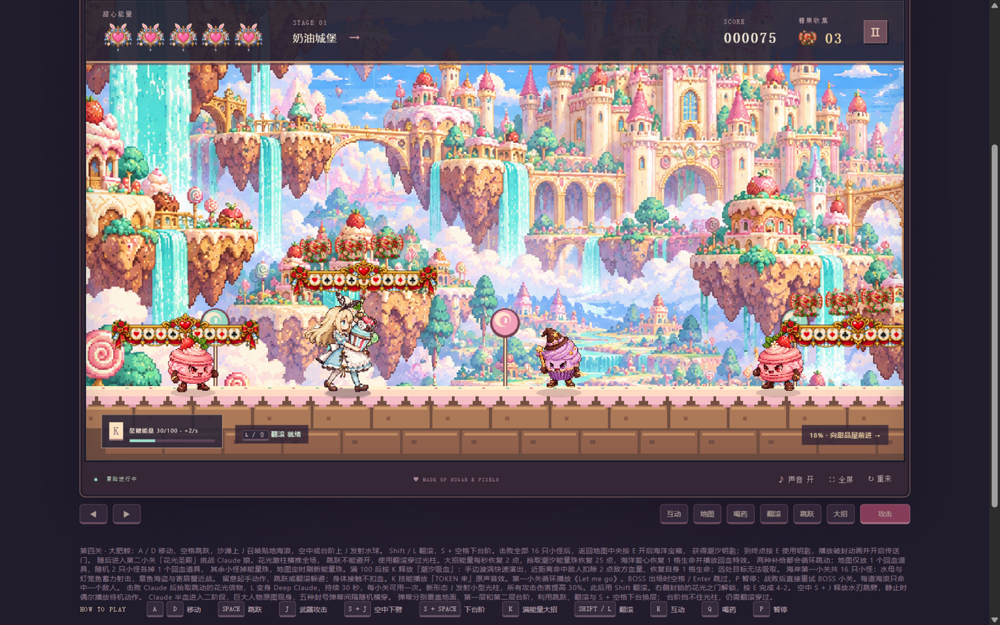

BOSS **火花 · 绯红魔术**：糕点魔术师，注意爆发齐射节奏。

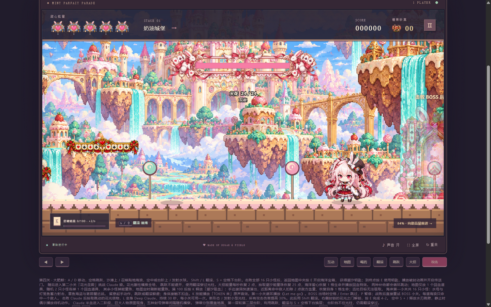

### 第 2 关 · 幽绿迷宫（BOSS：糯糯 · 两阶段）

穿过藤蔓迷宫，小心地刺与喷毒蘑菇；沿途有藤条小怪、孢子蘑菇和捕蝇花，三只猫猫宝箱各藏一瓶无敌药水。

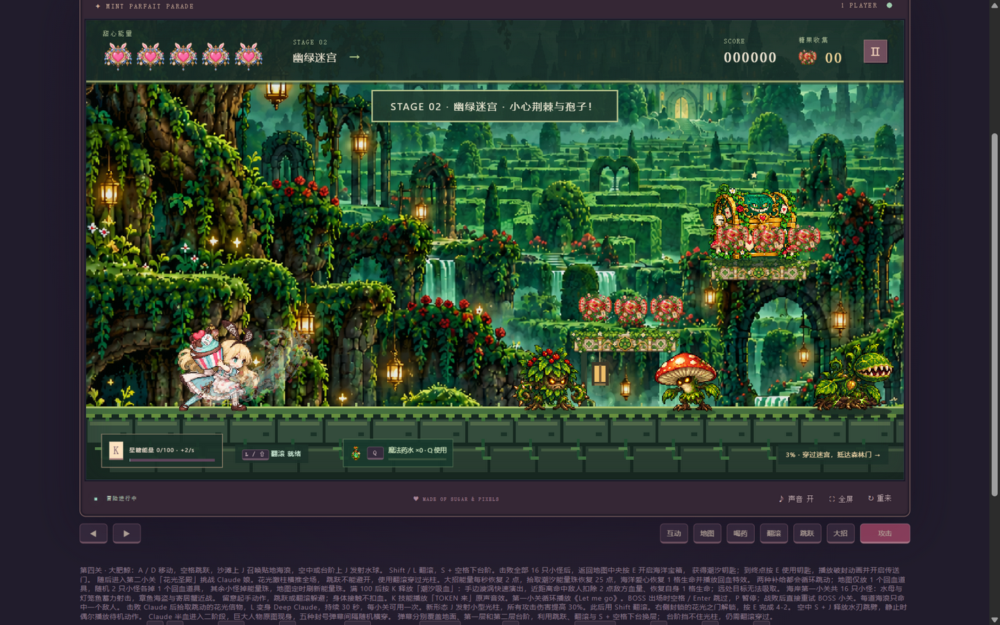

BOSS **糯糯 · 1 四叶守卫**（一阶段：飞叶齐射 / 根须震地）：

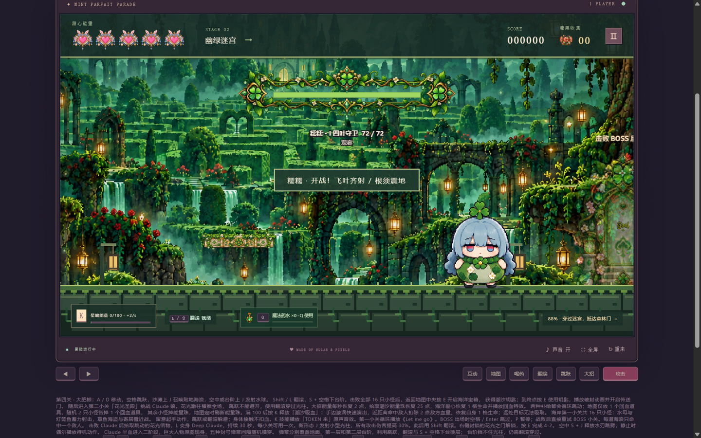

半血觉醒进入 **糯糯 · II 疯时狂怒**（二阶段连续出招，留意地面预警）：

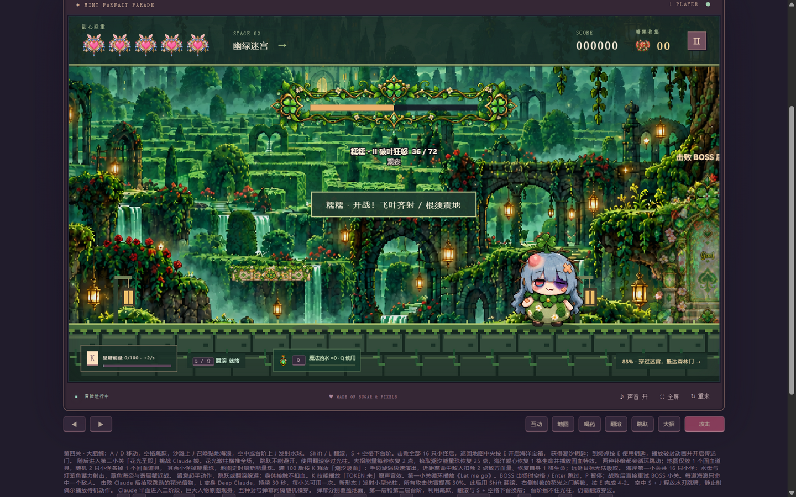

### 第 3 关 · 绯红时钟庭（BOSS：狂三 & 白之女王）

六个相连区域的探索关：绯红前厅、登塔、钥匙门与折返路线；小怪有发条甲胄、齿轮幽灵、影蝶，两只红黑时钟宝箱藏着魔法棒与药水。

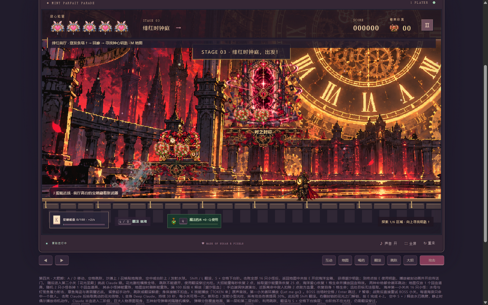

BOSS **时崎狂三**（爆发齐射 / 时间暂停，时停后立即躲枪弹）：

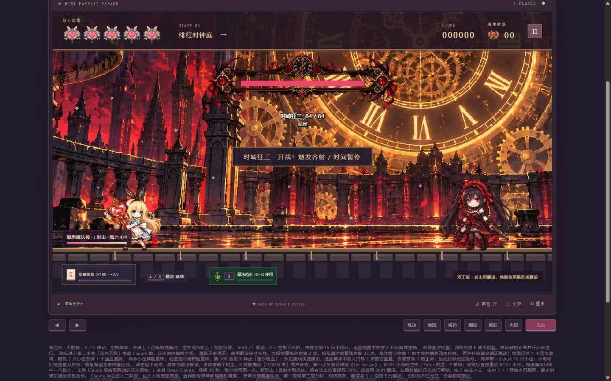

狂三半血召来 **白之女王**，进入双王战：紫晶斩击需要翻滚穿过，追踪地面剑可跳跃或翻滚躲避。

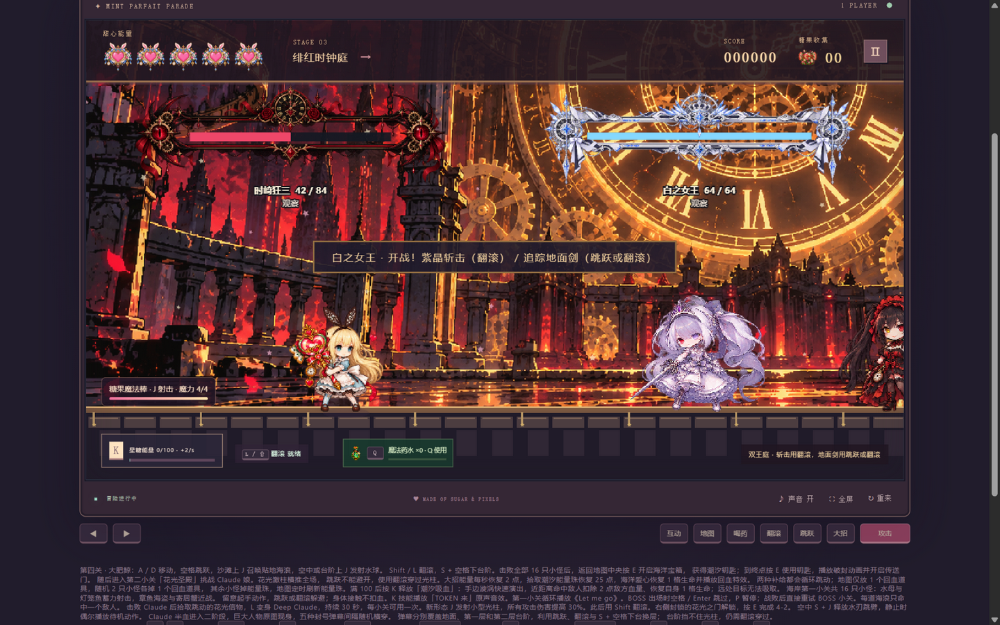

### 第 4 关 · 晴蓝潮汐海岸（BOSS：Claude 娘 · 花光圣殿）

大肥鲸的海岸探索：沙滩与台阶间共有 16 只小怪——水母法师与灯笼鱼蓄力射击，章鱼海盗与寄居蟹近战挥击；击败全部小怪开启海洋宝箱，解封传送门后进入第二小关「花光圣殿」。

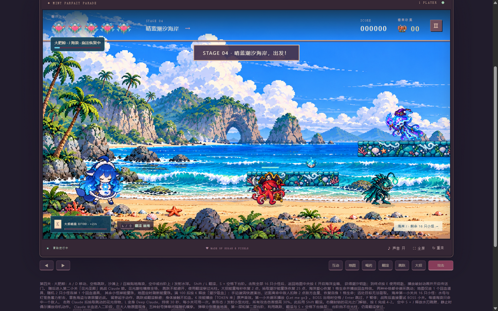

BOSS **Claude 娘**：花光激柱横推全场，跳跃不能避开，必须翻滚穿过；半血进入二阶段，五种封号弹幕随机横穿。

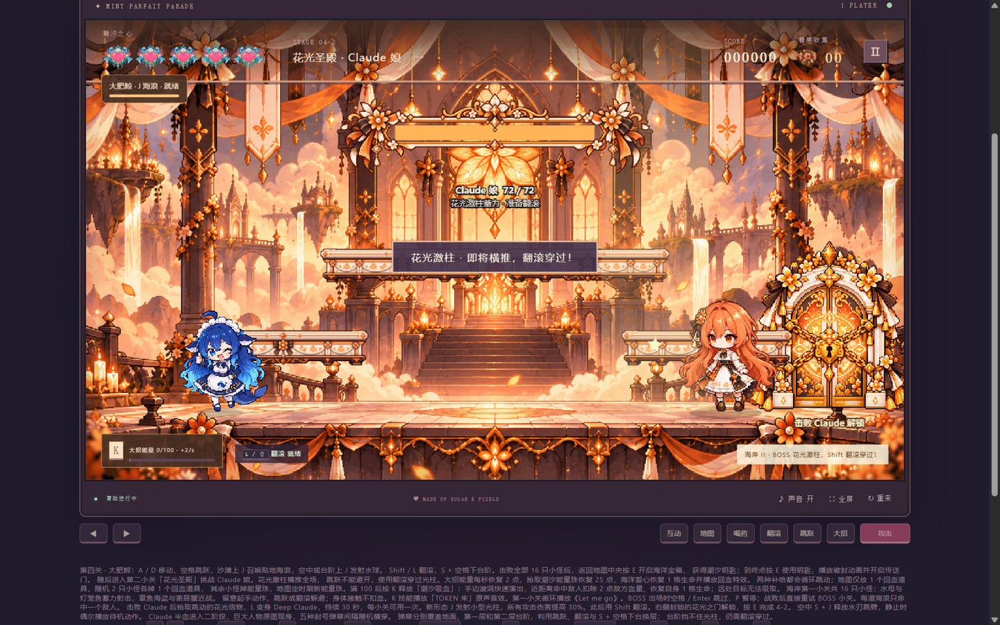

**Claude 娘 II · 半血形态**：血量过半后，巨大的「封号身影」降临花光圣殿，五种封号弹幕分覆盖地面与两层台阶——利用跳跃、翻滚与 `S` + `Space` 下台换层躲避；台阶挡不住光柱，光柱仍需翻滚穿过。


### 隐藏形态 · Deep Claude

击败 Claude 娘后拾取跳动的**花光信物**，按 `L` 变身 **Deep Claude**：持续 30 秒（每小关可用一次），所有攻击伤害提高 30%。

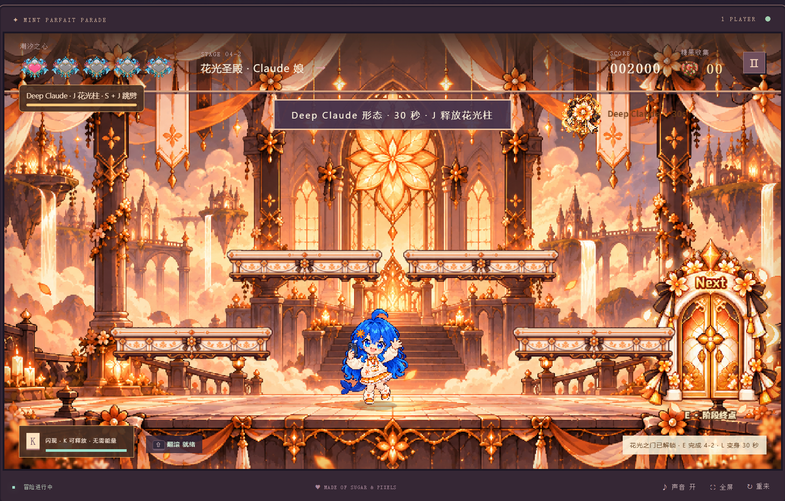

Deep Claude 形态下 `J` 释放小型花光柱（命中沿途第一个敌人），空中 `S` + `J` 释放水刃跳劈，`K` 潮汐吸血等全部攻击伤害统一提高 30%；右上角显示剩余变身秒数。

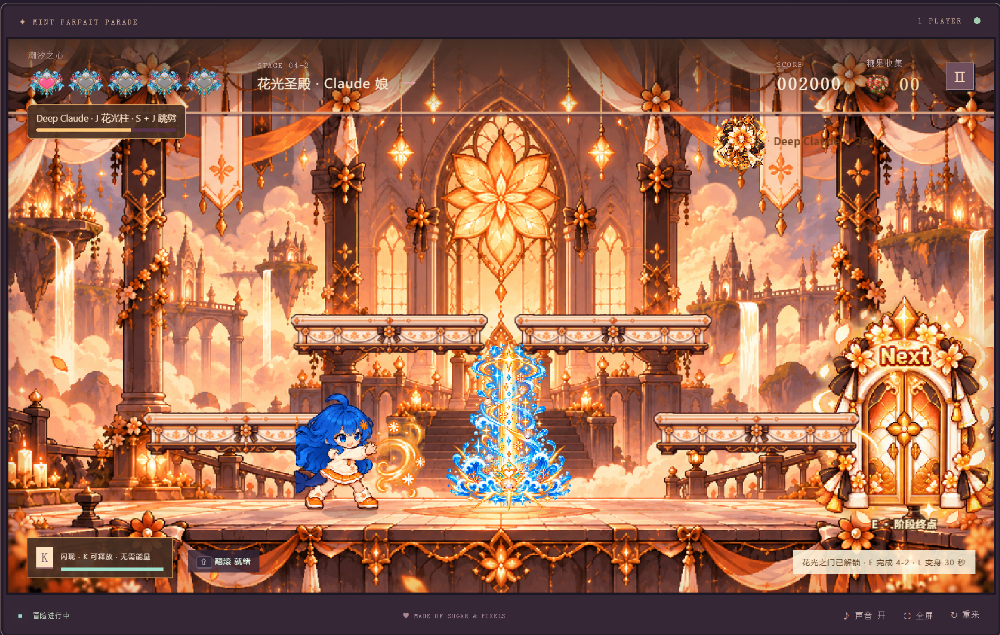

## 目录结构

```
├── README.md              # 本说明
├── LICENSE                # 个人娱乐使用授权声明（禁商用、禁抄袭、禁二次分发）
├── screenshots/           # 游戏截图
└── mint-parade/           # 游戏本体（可独立运行）
    ├── 启动游戏.bat        # 双击启动
    ├── 启动说明.txt        # 启动器说明
    ├── launch-game.ps1    # 启动脚本（自动选端口、复用服务）
    ├── serve.mjs          # 本地静态服务器
    ├── runtime/node.exe   # 内置 Node.js，无需安装依赖
    ├── index.html / style.css
    ├── game.js            # 主逻辑（第 1–3 关）
    ├── clock-stage.js     # 第 3 关逻辑
    ├── ocean-stage.js     # 第 4 关逻辑
    ├── assets/            # 美术与音频素材
    ├── ASSET-PROMPTS.md   # 素材生成提示词记录
    └── README.md          # 完整开发日志（版本更新说明）
```

## 声明

### 免责声明

- 本游戏为**个人自制的同人娱乐作品**，按「现状」提供。作者不对游戏作任何明示或默示的保证，包括但不限于适销性、特定用途适用性、无缺陷或中断运行。
- 下载、安装、运行本游戏的一切风险由使用者自行承担。因使用或无法使用本软件导致的任何直接或间接损失（包括但不限于数据丢失、设备问题、时间损失），作者不承担责任。
- 本游戏与 Anthropic、Claude、上海爱丽丝幻乐团、Team Shanghai Alice 等任何公司、组织或商标持有者均无隶属或合作关系；相关形象均为架空二次创作角色，与现实中的任何真实人物无关。
- 游戏内的音乐、美术素材为作者本人制作或授权使用，版权归相应权利人所有；若您的权利受到侵害，请提交 Issue 联系，将在确认后及时处理。

### 禁止商用声明

- 本游戏**仅供个人娱乐，严禁任何形式的商业用途**。
- 未经作者书面许可，不得：出售、出租、捆绑销售、付费下载、广告变现、用于直播打赏的商业推广、集成进任何收费产品或服务。
- 任何商业机构、平台或个人不得将本游戏或其素材用于盈利活动。如需授权合作，请先通过 Issue 联系作者并取得书面同意。

### 防抄袭声明

- 本仓库的**全部代码、美术素材、音频、关卡设计与文案均为原创成果**，受著作权法保护。
- 严禁任何人以任何方式抄袭、剽窃、盗用本游戏的内容，包括但不限于：将本游戏冒充为自己的作品发布、拆包提取素材或代码用于其他项目、去除或修改本声明后二次分发。
- **仅允许下载后自行游玩**：不得重新上传、转载至其他平台或网盘二次分发；不得制作修改版、破解版或衍生版本对外发布。
- 个人范围内的大小调整（如自行存档、修改存档数据）不在此限，但由此产生的问题由使用者自负。
- 发现侵权行为，作者保留追究法律责任的权利。

---

一口薄荷，一路冒险。
